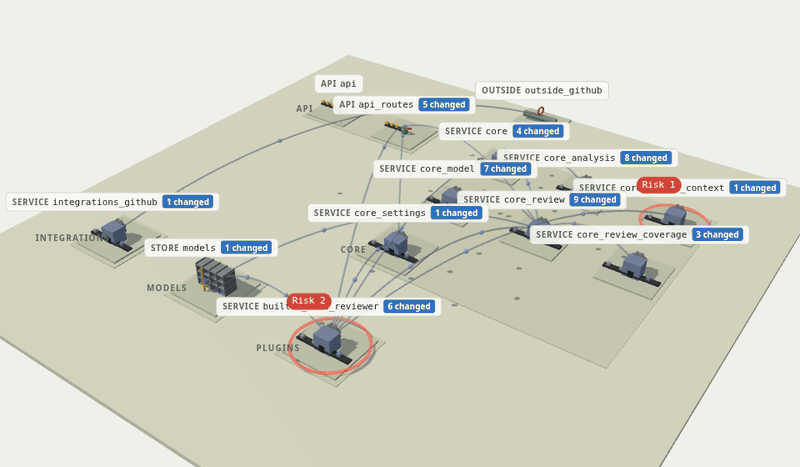
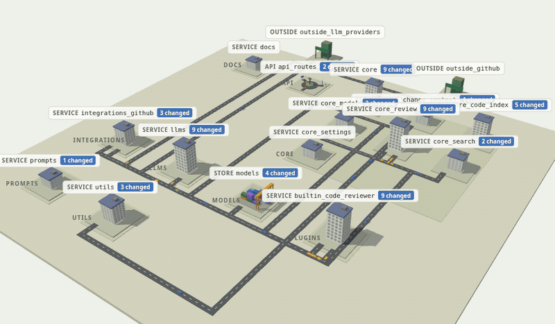

# Codetown

Describe software, or a change to it, in a few lines of plain words, and draw it as a scene where the work is visibly happening.



*sourceant#201 in the Machine language, generated from the pull request and the findings its review posted.*

```text
system "Corner Shop"
intent "Customers browse products and pay for orders"

service orders "Order service" size=4
  endpoint POST /orders
  function createOrder
  guard jwt

service payments "Payment service"
  function charge

database ordersdb "Postgres: orders"
external cards "Card network"

orders calls payments
orders writes ordersdb traffic=high
payments calls cards "card charges"

slow payments -> cards "Timeouts calling the card network"
risk 1 at payments "Unpaid orders when the card network times out" impact=hang certainty=conditional blast=many
```

Each place is drawn as something doing its job: an API routes requests to the endpoint they ask for, a pipeline runs work through one station per step, a store shelves what is written. Calls carry traffic between places. New ground is green, changed ground is blue, and removed work is cleared away.

## Install

```sh
npm install @sourceant/codetown
```

## Command line

```sh
codetown check shop.town                 # report problems; exits 1 on errors
codetown fmt shop.town --write           # rewrite in the canonical form
codetown render shop.town -o shop.svg    # draw it; --still for no animation, --theme light|dark
codetown diff before.town after.town     # one town showing how the first became the second
codetown json shop.town                  # the parsed town, for other tools
codetown words                           # every word, its meaning and its source
```

## Library

```ts
import { parse, render, diff, format } from '@sourceant/codetown';

const town = parse(source);
if (town.diagnostics.length) console.log(town.diagnostics);
const svg = render(town, { animate: true, theme: 'auto' });
```

`render` returns one self-contained SVG with its own light and dark styles. A page drawing several towns can pass `embedStyle: false` and include `codetownStyle` once. Every place carries `data-id`, every risk `data-risk` and every behavior `data-behavior`, so a page can make them clickable.

## Scene

`@sourceant/codetown/three` draws a town in WebGL, in one of three languages. three.js is a peer dependency: install it beside the package.

```ts
import { parse } from '@sourceant/codetown';
import { mountScene } from '@sourceant/codetown/three';

const scene = mountScene(element, parse(source), {
  language: 'City',
  theme: 'dark',
  onPick: ({ id }) => console.log('picked', id),
});
scene.select('core_review');   // fly to a place
scene.enter('core_review');    // show what is inside it
scene.setLanguage('Machine');
```

| Role | Icons | City | Machine |
| --- | --- | --- | --- |
| API | A panel of ports, one per endpoint | A roundabout with one signed exit per endpoint | A sorter whose gate turns each request down its endpoint's chute |
| Pipeline | Turning gears | A train line with one station per step | An assembly line with one press per step |
| Store | Stacked disks | A container yard; the crane stacks what is written | An automated rack; the lift shelves each write |
| Service | An app window | An office tower | A machine; grey work goes in and leaves done |
| Queue | A tube with packets | A bus stop with a line | A conveyor belt |
| Removed | A trash bin | A wrecking ball over rubble | A shredder |

In City, calls are streets with cars on them; in Icons and Machine they are lines with traffic flowing along them.



*sourceant#209 in the City language: 128 changed files, 16 calls between the parts they touch.*

### Story and tour

`story(town, id)` tells one place's part in the change as data: what it is, what this change does to it, the behaviors and risks on it (each risk read as a scenario, such as "When a signed-in user acts, the answer is wrong for one user"), whether a test names it, and what it calls, is called by, sits beside and changed with. `tour(town)` walks the whole change, place by place. Neither needs three.js.

## The language

One statement per line. `#` starts a comment.

| Write | Means |
| --- | --- |
| `system "Name"` | The system being drawn |
| `intent "..."` | What the system or change is for, shown on a banner |
| `purpose fix "..."` | What a change is for, as a Conventional Commits type |
| `district id "Label"` | A neighbourhood; places join it with `in=id` |
| `service id "Label" in=core size=1-5` | A place: `service`, `database`, `cache`, `queue`, `topic`, `external`, `person` and others |
| indented `function name` | A member inside the place above: `endpoint`, `function`, `class`, `config`, `job`, `guard` and others |
| `a calls b "label" traffic=low\|normal\|high` | A link: `calls`, `reads`, `writes`, `sends`, `triggers` and others |
| `bug a.member "why"`, `slow a -> b` | A condition on a place, a member or a link |
| `risk 1 at target "text" impact= certainty= blast= trigger=` | A finding, drawn as the hazard its impact names |
| `behavior B1 at target "before" -> "after"` | A numbered signpost for a change in behavior |
| `test target "name" count=2` | An inspector's badge |
| `trip id: a -> b -> c` | A vehicle travelling that path |

A mark before a line says how a change touched it: `+` added, `~` modified, `-` deleted, `>` renamed, `*` copied, `!` type changed. Added work gets a crane, modified work scaffolding, deleted work is boarded up.

Every word comes from a vocabulary engineers already publish and use: the C4 model, ArchiMate, the Language Server Protocol's symbol kinds, Enterprise Integration Patterns, git's change letters, the dependability taxonomy of Avizienis et al., the SRE golden signals and Conventional Commits. [VOCABULARY.md](VOCABULARY.md) lists each word with its source.

## Examples

`examples/` holds towns written by hand and towns generated from real pull requests to [sourceant/sourceant](https://github.com/sourceant/sourceant), with the findings its review posted on them. They range from a dozen lines to more than a hundred parts and calls.

| Town | Pull request |
| --- | --- |
| `corner-shop.town` | Written by hand |
| `pr-209.town` | Written by hand from sourceant#209 |
| `retire-billing.town` | Written by hand: a service removed and replaced |
| `sourceant-175.town` | Read a system's connections in the background |
| `sourceant-189.town` | Configure parallel passes and reliable findings delivery |
| `sourceant-192.town` | Add architecture inspection and MCP skills |
| `sourceant-194.town` | Add groups, groupables and grouping for requirements |
| `sourceant-201.town` | Add parallel discovery and evaluation |
| `sourceant-209.town` | Add repository context and scale large reviews |

## Worlds

The language names concepts once; a world draws them. `world town` is the only world drawn so far. `body`, `workshop` and `bank` are accepted and drawn as the town until their symbols are built.
